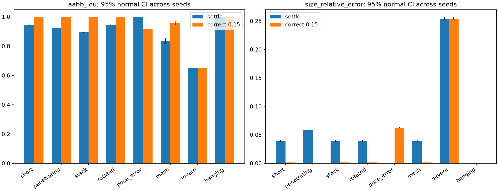
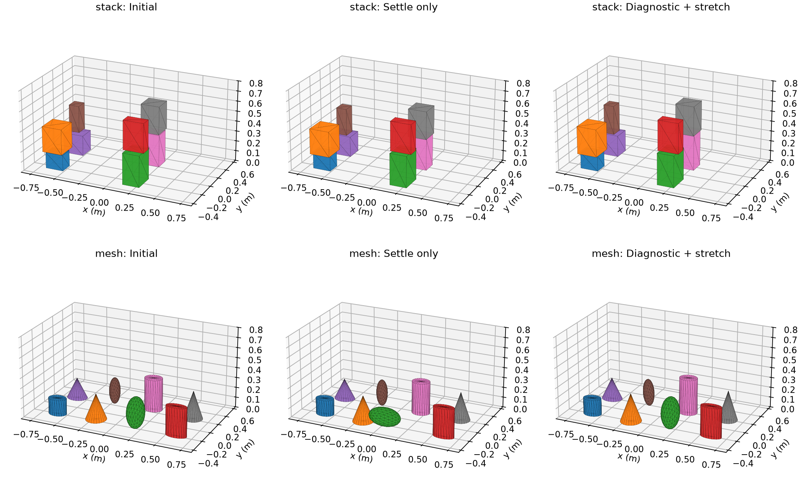

<div align="center">

<h1>SimuScene: Simulation-Ready Compositional 3D Scene Reconstruction from a Single Image [Reproduction]</h1>

<p><strong>Scene geometry · Physical consistency · MuJoCo simulation</strong></p>

<p>Independent implementation · Reproducible evidence · Transparent limitations</p>

<p>
<a href="https://arxiv.org/abs/2606.03994"></a>


<a href="https://github.com/gulucaptain/SimuScene-Reproduction/actions/workflows/tests.yml"></a>
<a href="LICENSE"></a>
</p>

<p><a href="https://arxiv.org/abs/2606.03994">📄 Paper</a> · <a href="results/round05/REPORT.md">📊 Results</a> · <a href="COVERAGE.md">🔍 Coverage</a> · <a href="ITERATIONS.md">🧪 Iterations</a></p>

</div>

## 🎯 Reproduction at a glance

| | Scope & evidence |
|:--|:--|
| 🧩 **Implemented** | Sequential placement, penetration correction, gravity diagnostics and attachment constraints. |
| 🧪 **Validated locally** | Five local cycles · 64 seeds · eight scene families · 2,048 final synthetic runs. |
| 🔎 **Remaining gaps** | Geometry/physics components only; no complete image-to-scene pipeline or original benchmarks. |

> [!IMPORTANT]
> This is an independent, partial reproduction—not the authors’ official implementation. Local experiments do not establish full paper-result reproduction.

---

This project independently implements and tests the geometry/physics portions of **SimuScene: Simulation-Ready Compositional 3D Scene Reconstruction from a Single Image**. It is **not a completed end-to-end reproduction** and is not the authors' code.

## 🎯 Scope and status

Implemented: CPU MuJoCo simulation; sequential placement; environment-priority penetration resolution; first-contact gravity diagnostics; canonical-axis stretch preserving the top OBB face; single/double attachment constraints; triangle-mesh inputs with V-HACD collision decomposition; a learned-resampler callback; depth-visible scale/translation alignment candidates; multiseed evaluation. No ground-truth geometry is passed into the correction algorithm.

Missing: image decomposition (SAM3/RAM++/VLM), SAM3D generation, FoundationPose refinement, actual SAM3D LoRA/FM-DPO training and learned resampling, full silhouette-based candidate ranking, original GraspClutter6D/ADT/GenWild benchmarks and downstream robot policies. Severe cases are explicitly recorded as unresolved. Anchored penetration requiring constrained resolution is reported as failed rather than silently translated. These limitations prevent claiming the paper's tables are reproduced.

## ⚙️ Installation

Python 3.12 is required. Run the following commands from a fresh clone:

```sh
git clone https://github.com/gulucaptain/SimuScene-Reproduction.git
cd SimuScene-Reproduction
python3.12 -m venv .venv
source .venv/bin/activate
python -m pip install --upgrade pip
python -m pip install -e '.[dev]'
python -m pytest tests -q
python scripts/verify_results.py
```

For the recorded macOS environment, use `python -m pip install -c requirements-lock.txt -e '.[dev]'`. The lock records tested versions on this Mac; it is not a universal cross-platform lock.

## 🔁 Rebuild experiments

```sh
OPENBLAS_NUM_THREADS=1 VECLIB_MAXIMUM_THREADS=1 .venv/bin/python -m simuscene.experiment --round 5 --seeds 64 --workers 8
.venv/bin/python -m simuscene.report
```

Results are saved under `results/round05`. Running again overwrites that round's outputs, so copy the directory before a new comparison. No cache is needed: procedural scenes are generated from logged seeds. Historical source snapshots for each development stage are retained under `results/roundXX/source`; later stages use the final executable unless those snapshots are restored. Raw JSON records all object states, reference geometry, branch decisions and per-run metrics. Manifests record arguments, source hashes, platform and elapsed time.

## 🚀 Prepared mesh scenes

Use `python -m simuscene.run_scene input.json output.json`. Input format:

```json
{"objects":[{"name":"object_0","size":[0.2,0.2,0.3],"position":[0,0,0.18],"quat":[1,0,0,0],"mesh":"procedural:cone"}]}
```

`size` is full canonical extent in metres; position is world-space centre; quaternion is wxyz. `mesh` may also be an absolute triangle-mesh file path. External meshes are canonicalized using their oriented bounding box. Convex meshes use a direct hull; concave meshes are decomposed by V-HACD (at most 16 hulls, resolution 100000). This is an approximate decomposition and its parameters are local assumptions. `anchor` contains one or two body-local attachment coordinates; they connect to world positions at model construction. The implementation uses an implicit Z=0 floor. Scene import does not infer walls, masks, camera or dimensions from photographs.

## 📊 Results and five iterations

Final controlled suite: 64 seeds, eight scene families, four method/threshold settings (2,048 runs). Stack AABB IoU improves from 0.89443 to 0.99660; pose-only error cases decrease from 0.99939 to 0.91918. Severe shape errors have an unresolved fraction of 1.0. These are synthetic diagnostics, not original-dataset results.

See [iteration log](ITERATIONS.md), [final measurements](results/round05/REPORT.md), [full source evidence](sources/manifest.json), and [coverage](COVERAGE.md).




The synthetic suite is a diagnostic evaluation, not a replacement for the original datasets. In particular, `pose_error` deliberately violates the assumption that pose has already been corrected; failures are retained. The 0.15 branch threshold follows the paper; 0.05 and 0.30 are sensitivity experiments. No alternative threshold is selected using ground truth. Reported error bars are across seeds, not across individual objects.

## 📄 Source

[Paper original](https://arxiv.org/html/2606.03994v1). See `sources/manifest.json` for retrieval date and SHA-256.

## 🧠 Verified original training requirements

The paper's implementation paragraph specifies V-HACD collision geometry, 16.6K cached latent preference pairs (8.3K per type), beta=500, rank-64 LoRA with alpha=128 across 120 linear layers in 24 Stage-1 MM-DiT blocks, global batch 16, AdamW lr=1e-5, weight decay=.01, 300 warmup steps, bf16, 1,500 steps on four RTX PRO 6000 Blackwell GPUs. These settings were recovered during final source audit; the earlier feasibility discussion had not established them. The unavailable cached pairs/adapters and CUDA dependencies remain the blockers, not an absence of these published hyperparameters.

## ✅ Verification and license

`python scripts/verify_results.py` checks all five archived source snapshots against their recorded hashes and rebuilds the final numerical summaries from raw records. CPU tests and this verification run in GitHub Actions. MPS measurements require an Apple Silicon machine and are not rerun by Linux CI.

Original code is released under the [MIT License](LICENSE); see [NOTICE](NOTICE) and [software citation metadata](CITATION.cff). Cite the original paper linked above when using its method.

---

## 🧭 Reproduction collection

Independent research implementations with recorded configurations, experimental evidence and explicit limitations.

| Project | Focus |
|:--|:--|
| [Directional Stationarity](https://github.com/gulucaptain/Directional-Stationarity-Reproduction) | Nonsmooth optimization |
| [Quadratic Bézier Splatting](https://github.com/gulucaptain/Quadratic-Bezier-Splatting-Reproduction) | Stroke-based rendering |
| [KoalaGS](https://github.com/gulucaptain/KoalaGS-Reproduction) | Continuous Gaussian LoD |
| [PhySPRING](https://github.com/gulucaptain/PhySPRING-Reproduction) | Physics-informed graph reduction |
| [MatrixSplat](https://github.com/gulucaptain/MatrixSplat-Reproduction) | Matrix-based Gaussian rendering |
| **SimuScene** · this project | Scene geometry and physics |
